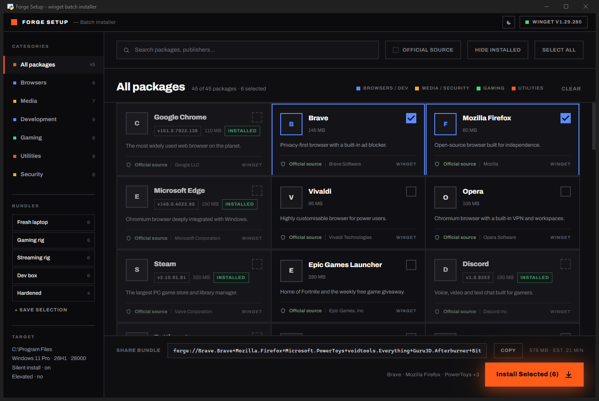
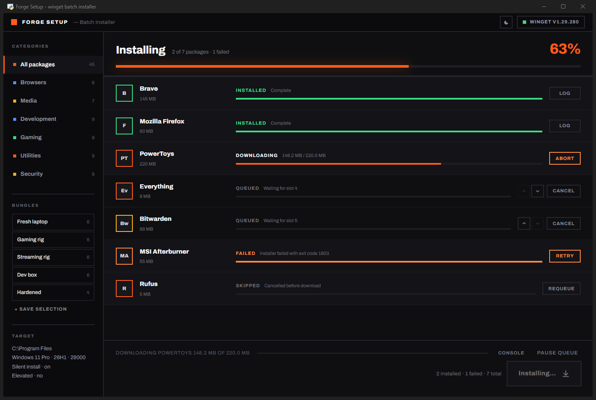
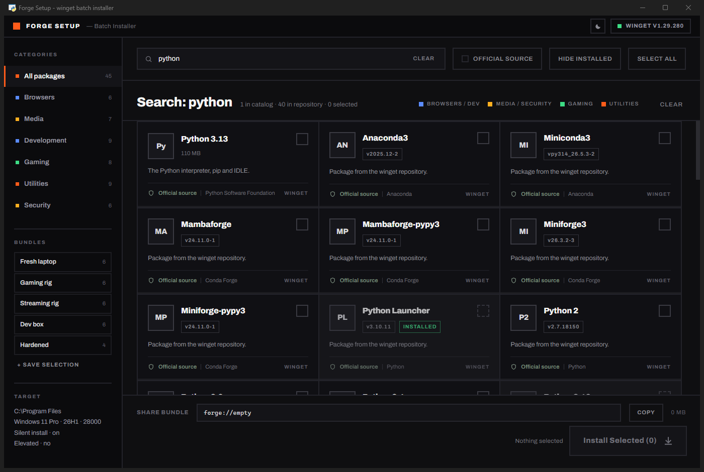
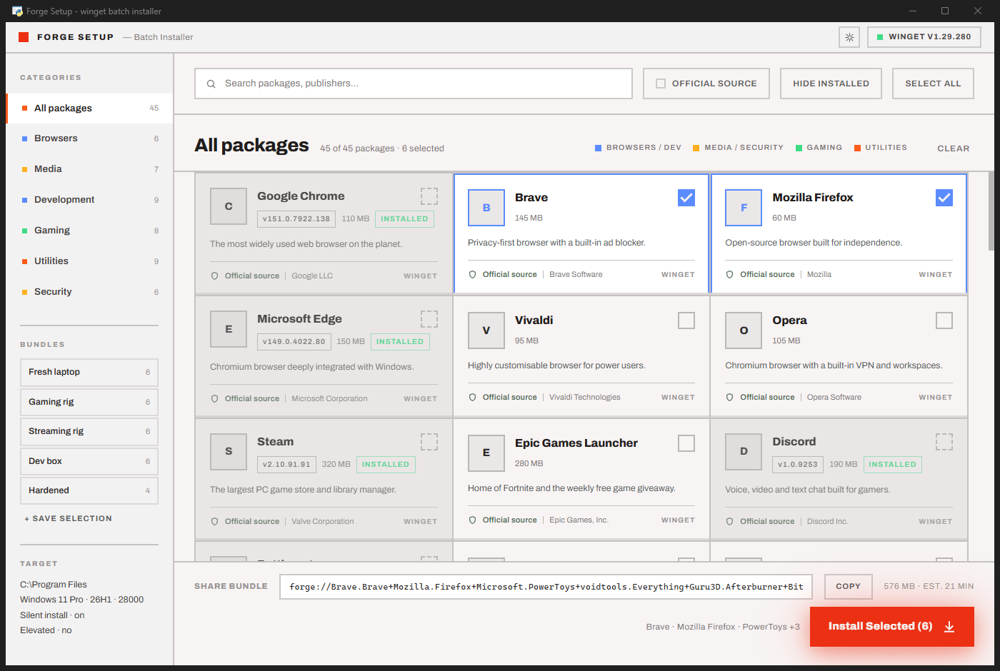

<div align="center">

# InstaDeck

**A visual batch installer for Windows, built on top of `winget`.**

Pick packages from a curated catalog or search the entire winget repository,
then install them in one queued run — with live progress, reordering,
and per-package retry.


</div>

---



## What it is

`winget` is excellent and setting up a new Windows machine with it is still
tedious: one command per package, no overview, no idea what is already
installed, no way to hand someone else your setup.

InstaDeck puts a real interface on it. Select what you want, hit install once,
and watch the queue work through it. Everything on screen comes from the actual
`winget` CLI running in the background — the catalog is real package
identifiers, the installed badges come from `winget list`, and the progress bars
are parsed from live installer output.

## Features

- **Curated catalog** — 45 packages across 7 categories, each pinned to a real
  winget identifier.
- **Full repository search** — anything the catalog does not cover, `winget
  search` does. Catalog hits and repository hits are reported separately.
- **Installed detection** — one `winget list` pass marks what is already on the
  machine, with its version, and takes it out of the selection.
- **Bundles** — five built in (Fresh laptop, Gaming rig, Streaming rig, Dev box,
  Hardened), plus *Save selection* to store your own.
- **Portable profiles** — export a selection as an `.instadeck.json` file and import
  it on another machine.
- **Share strings** — a selection encodes to `instadeck://Pkg.One+Pkg.Two`. Paste one
  back in to restore it on another machine.
- **Upgrade mode and preflight** — surface catalog updates, then check disk
  space, installer conflicts, and elevation before a run begins.
- **Live install queue** — per-package progress, reorder what has not started,
  cancel, abort, retry a failure, requeue a skip.
- **History and completion actions** — completed runs persist locally; optionally
  launch installed apps, open package pages, or run an explicitly entered
  PowerShell command afterward.
- **Dark and light themes**, a **portable `.exe`**, and a Windows setup wizard.

---

## The install queue

Packages install one at a time — `winget` takes a global machine lock, so
running two at once would only make them deadlock. The queue is live: anything
still `QUEUED` can be reordered or cancelled while the package above it is
downloading.



Each row carries its own state and progress. `DOWNLOADING` percentages come from
winget's byte counter; `VERIFYING HASH` is winget checking the installer against
the manifest before it runs; failures show winget's own error text rather than a
bare exit code.

## Repository search



## Light theme

Dark is the designed default. The light theme is built from the same design
system's light tokens rather than being inverted.



---

## Running it

### Portable executable

Build it with `build.bat`, then run `dist\InstaDeck.exe`. One self-contained
file, no installation, no Python needed — copy it to a USB stick or a fresh
machine and double-click.

Requirements: **winget** (ships with Windows 11 as *App Installer*) and the
**Edge WebView2 runtime** (also preinstalled on Windows 11).

> Run it **as administrator** to install machine-wide packages without a UAC
> prompt for each one. The sidebar's Target block shows your current elevation.

### From source

```
run-dev.bat                 # or: python app.py
python app.py --debug       # opens WebView2 devtools
```

Both `.bat` launchers prefer `%LOCALAPPDATA%\Programs\Python\Python310\python.exe`
if present and fall back to `python` on `PATH`. Any interpreter works as long as
`pywebview` is installed into it:

```
pip install -r requirements.txt
```

---

## How it works

```
app.py             pywebview window + the JS <-> Python bridge (class Api)
core/winget.py     all subprocess work: probe, list, search, install queue
core/catalog.py    45 packages, 7 categories, 5 bundles, the hue legend
web/               index.html · styles.css · app.js · fonts/archivo.woff2
InstaDeck.spec     PyInstaller recipe for the single-file build
```

A native window (Edge WebView2 via [pywebview](https://pywebview.flowrl.com/))
renders the UI; Python drives `winget` in background threads and streams events
into the page.

**Threading.** pywebview serves `Api` methods over a threaded local endpoint, so
a slow call — a repository search, a full installed scan — runs on its own thread
and never blocks the UI. Installs run on a worker thread that pushes events back
through `Api._push` → `window.__push(event)`.

**The queue is a lock-guarded mutable list.** The worker always pulls the first
entry still marked `queued`, which is precisely what makes reordering and
skipping possible while a package is mid-install.

**Pause is not abort.** *Pause queue* sets a flag so the worker stops after the
package currently installing — nothing is killed. *Abort* terminates the running
winget process and its installer children via `taskkill /T`. Two different
promises, so two different buttons.

**Progress parsing.** winget rewrites its progress bar in place with carriage
returns, so the installer reads the raw byte stream and splits on `\r` *and*
`\n` instead of reading lines. Percentages come from the `12.4 MB / 78.9 MB`
counter — the only progress signal winget emits once its stdout is a pipe.

**Table parsing.** `winget list` and `winget search` output fixed-width columns.
Boundaries are taken from the header row rather than by splitting on whitespace,
because package names routinely contain single spaces.

**Failure reporting.** Exit codes are trusted only where unambiguous
(`0x8A150014` no package found, `0x80070005` access denied, MSI `1602/1603/1618`,
and `3010/1641` which mean success-pending-reboot). Otherwise the row shows
winget's own error line, and the "relaunch as administrator" hint appears only
when the failure actually implicates elevation.

The command behind every row:

```
winget install --id <AppID> -e --silent
               --accept-package-agreements --accept-source-agreements
               --disable-interactivity
```

---

## On "Official source"

The design this UI was built from labelled every package **Signed** or
**Unsigned** and offered a filter on it. winget does not expose installer
signature status through its CLI, so shipping that label would have meant
inventing a security claim inside a security filter.

What winget *does* report is the **source** a manifest came from, so the shield
row shows provenance instead:

| Badge | Meaning |
| --- | --- |
| **Official source** | `winget` — the community repository, where manifests are reviewed and installer hashes are pinned — or `msstore`. |
| **Third-party source** | Any other repository registered on the machine. |

The integrity check that *is* real — winget verifying the installer hash against
the manifest before executing it — appears as the `VERIFYING HASH` state in the
queue, driven by winget's own output.

---

## Design

The interface implements a **Modernist** design system: zero corner radius, 2px
structural borders, hairline seams drawn by a 2px grid gap over a lighter
ground, [Archivo](https://fonts.google.com/specimen/Archivo) throughout, and a
four-hue category legend over an electric-orange accent.

| Role | Dark | Light |
| --- | --- | --- |
| Accent | `#ff5c1a` | `#ec3013` |
| Page | `#08080a` | `#e2dfdf` |
| Window | `#0f0f11` | `#f8f4f4` |
| Rail / panel | `#0b0b0d` | `#f3f2f2` |
| Structural border | `#23232a` | `#c6c2c2` |
| Card | `#101014` | `#f8f4f4` |
| Text ramp | `#f6f6f5` → `#5f5f68` | `#201e1d` → `#9b9797` |

Category hues are shared by both themes, because they *are* the legend:

🟦 `#5b8cff` browsers / dev &nbsp;&nbsp; 🟨 `#ffb020` media / security &nbsp;&nbsp;
🟩 `#3ddc84` gaming &nbsp;&nbsp; 🟧 `#ff5c1a` utilities

Archivo is bundled locally (variable weight, latin subset, 35 KB) rather than
loaded from a CDN, so the app renders correctly offline and inside the frozen
build.

### Keyboard

| Key | Action |
| --- | --- |
| <kbd>Ctrl</kbd> <kbd>F</kbd> | Focus search |
| <kbd>Esc</kbd> | Clear search |
| <kbd>Ctrl</kbd> <kbd>`</kbd> | Toggle the console |

---

## Extending the catalog

Add an entry to `APPS` in [`core/catalog.py`](core/catalog.py):

```python
_app("Publisher.AppId", "App Name", "Publisher", "utils",
     "One-line description.", 120, "#2F67BA", "AB")
```

`120` is the approximate installer size in MB (used for the selection estimate)
and `"AB"` is the monogram drawn on the tile. The category id supplies the hue
automatically. Bundles reference packages by winget id.

---

## Rights

**All rights reserved.** This repository is published for viewing only. No
licence is granted to use, copy, modify, redistribute, or build on this code.

It is public so it can be read and shown — not so it can be reused. If you want
to do something with it, ask first.

<div align="center">
<sub>Not affiliated with Microsoft. <code>winget</code> is Microsoft's package manager;
this is an independent front-end for it.</sub>
</div>
